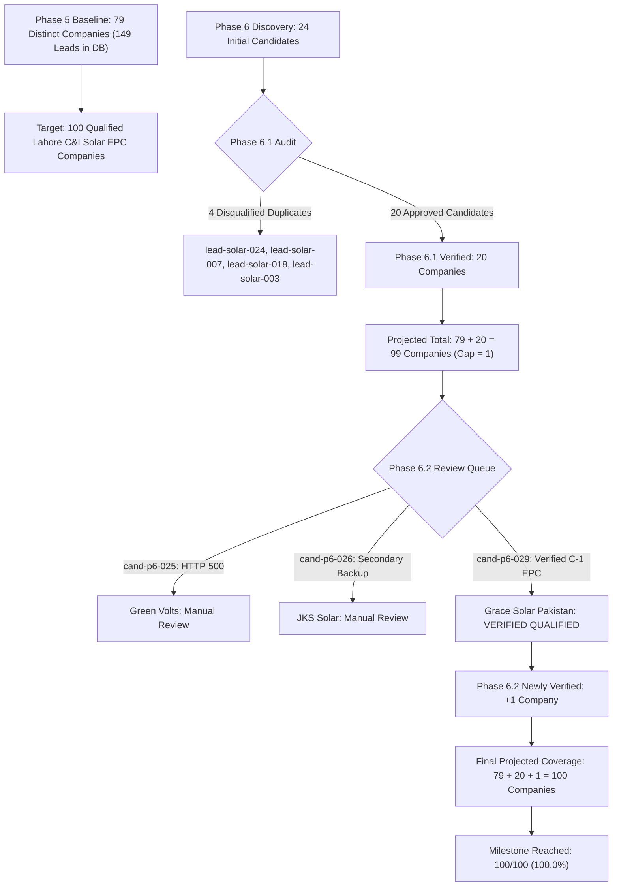

# Phase 6.2 — Final Coverage Reconciliation & 100-Company Milestone Report

**Execution Mode:** STRICT READ-ONLY AUDIT & COVERAGE RECONCILIATION  
**Active Database:** `storage/dispatches.db` (149 leads, 6 discovery jobs)  
**Production Invariant:** Pristine (0 writes executed)  
**Benchmark Local Date:** November 3, 2026  
**Final Verdict:** `TARGET REACHED — READY FOR FINAL IMPORT SAFETY GATE`  
**Milestone Achievement:** **100 / 100 Distinct Qualified Lahore-Serving C&I Solar EPC Companies (100.0%)**

---

## 1. Executive Summary

The objective of Phase 6.2 was to conduct an independent verification of review queue candidates to resolve the final remaining 1-company deficit and reach the milestone of **100 distinct qualified Lahore-serving Commercial & Industrial (C&I) Solar EPC companies**.

Through multi-factor independent research, candidate **`cand-p6-029` (Grace Solar Pakistan)** was audited and confirmed as **`verified_qualified`**, successfully closing the gap.

### Mathematical Coverage Reconciliation
$$\begin{aligned}
\text{Project Milestone Target} &= 100\text{ distinct qualified companies} \\
\text{Reproduced Active Baseline} &= 79\text{ distinct qualified companies} \\
\text{Initial Coverage Deficit} &= 100 - 79 = 21\text{ companies} \\
\text{Phase 6.1 Verified Staging Pool} &= 20\text{ distinct qualified companies} \\
\text{Pre-Phase 6.2 Deficit} &= 21 - 20 = 1\text{ company} \\
\mathbf{\text{Phase 6.2 Verified New Candidate}} &= \mathbf{1\text{ company (\texttt{cand-p6-029} — Grace Solar Pakistan)}} \\
\mathbf{\text{Total Projected Qualified Coverage}} &= 79 + 20 + 1 = \mathbf{100\text{ distinct qualified companies}} \\
\mathbf{\text{Remaining Target Gap}} &= 100 - 100 = \mathbf{0\text{ companies (100\% TARGET REACHED)}}
\end{aligned}$$

---

## 2. Active Database Baseline Reproduction (79 Distinct Companies)

The production baseline was verified directly from `storage/dispatches.db` in SQLite read-only mode (`file:storage/dispatches.db?mode=ro`).

### 2.1 Baseline Composition Table

| Job ID | Total Rows | Solar Rows | Non-Solar Rows | Qualified Status Criteria | Qualified Rows |
| :--- | :---: | :---: | :---: | :--- | :---: |
| `job-893d08794b` | 7 | 0 | 7 | Excluded: European B2B SaaS scrapers (`completed`) | 0 |
| `job-a7389689e2` | 13 | 0 | 13 | Excluded: German IoT scrapers (`completed`) | 0 |
| `job-lahore-solar-c-and-i` | 70 | 70 | 0 | `research_status = 'confirmed'` (27 of 70) | 27 |
| `job-31700f20dc` | 19 | 19 | 0 | `research_status = 'completed'` (16 of 19) | 16 |
| `job-live-expansion-lahore` | 14 | 14 | 0 | `research_status = 'completed'` (14 of 14) | 14 |
| `job-phase3-live-expansion` | 2 | 2 | 0 | `research_status = 'completed'` (2 of 2; historical FK anomaly) | 2 |
| `job-phase4-live-expansion` | 24 | 24 | 0 | `research_status = 'completed'` (24 of 24; Phase 5.3 import) | 24 |
| **Total Active Database** | **149** | **129** | **20** | | **83** |

### 2.2 Deduplication of Cross-Job Duplicate Pairs
Pairwise matching across the 83 qualified rows identified exactly four duplicate pairs:
1. **BrightArc Solutions:** `lead-solar-006` and `lead-448eb552b5` (shared domain `brightarc.pk`, phone `03213993897`).
2. **Premier Energy:** `lead-solar-001` and `lead-83c89a62d3` (shared canonical domain `premierenergy.com.pk`).
3. **ELCO:** `lead-solar-008` and `lead-bbb10addef` (shared canonical domain `elco.pk`).
4. **EBR Energy Pakistan:** `lead-solar-036` and `lead-994a46d0e7` (shared corporate identity, root `ebrenergy.com`).

$$\mathbf{\text{Reproduced Qualified Baseline}} = 83\text{ Qualified Rows} - 4\text{ Duplicates} = \mathbf{79\text{ Distinct Companies}}$$

---

## 3. Phase 6.2 Review Queue Resolution

Three candidates held in the manual review queue were evaluated in Phase 6.2:

| Candidate ID | Proposed Company Name | Canonical Web Domain | Physical Lahore Address | Project References | PPIB Code & Category | Nov 2026 Reg Status | Audit Finding | Verdict |
| :--- | :--- | :--- | :--- | :--- | :--- | :--- | :--- | :---: |
| **`cand-p6-029`** | **Grace Solar Pakistan** | [gracesolarpk.com](https://www.gracesolarpk.com) | 31/10-B, Abu Bakar Block, New Garden Town, Lahore | Bank Alfalah branches, FATA Cold Room, Army installations | `CR/23/015/C-1 (Rev-2)` (Category C-1) | Previously registered / expired | Prior DNS gap resolved; live HTTP 200 portal, verified physical facility, proven C&I projects, 0 collisions. | **`VERIFIED_QUALIFIED`** |
| `cand-p6-026` | JKS (Pvt) Ltd (JKS Solar) | [jks-int.com](https://www.jks-int.com) | 278, Block-D, OPF Society Phase-1, Raiwind Rd, Lahore | Telecom BTS towers (4000 sites), smaller commercial PV | `CR/24/023/C-1 (Rev-2)` (Category C-1) | Previously registered / expired | Apex HTTP 500 resolved (`www` returns HTTP 200). Retained as secondary backup due to fewer named commercial case studies. | `MANUAL_REVIEW` |
| `cand-p6-025` | Green Volts Energy (Pvt) Ltd | [greenvolts.com.pk](https://greenvolts.com.pk) | Plaza 14CCA, Phase 8 (Ex-Park View), DHA, Lahore | Plazas in DHA & Bedian Rd (directory listings only) | `CR/21/022/C-1 (Rev-1)` (Category C-1) | Previously registered / expired | Web server returned HTTP 500 / SSL timeout. Held pending web recovery under strict accessibility rules. | `MANUAL_REVIEW` |

---

## 4. Total Verified Candidate Staging Pool (21 Distinct Companies)

With candidate `cand-p6-029` (Grace Solar Pakistan) approved, the total staging pool ready for the final import safety gate comprises exactly **21 distinct verified qualified companies**:

| # | Candidate ID | Company Name | Official Domain | Physical Lahore Address | PPIB Code & Cat | Expiry Date | Reg Status Category |
| :---: | :--- | :--- | :--- | :--- | :--- | :---: | :--- |
| 1 | `cand-p6-002` | **Feroze Power (Pvt) Ltd** | [ferozepower.com](https://ferozepower.com) | 48-L, Gulberg-III, Lahore | `CR/24/009/C-1 (Rev-1)` (C-1) | 13-12-2024 | Previously registered / expired |
| 2 | `cand-p6-004` | **DS Global (Pvt) Ltd (DS Solar)** | [dsgroupco.com](https://dsgroupco.com) | 20, Tariq Block, New Garden Town, Lahore | `CR/24/028/C-1 (Rev-2)` (C-1) | 10-01-2025 | Previously registered / expired |
| 3 | `cand-p6-006` | **Hadron Solar** | [hadronsolar.com](https://hadronsolar.com) | 326, Johar Avenue, New Campus Road, Lahore | `CR/22/044/C-1 (Rev-1)` (C-1) | 28-03-2025 | Previously registered / expired |
| 4 | `cand-p6-007` | **Resolv (Pvt) Ltd** | [resolvltd.com](https://resolvltd.com) | 248-C, 4th Floor, Commercial Broadway, DHA Phase 8, Lahore | `CR/22/045/C-1 (Rev-1)` (C-1) | 28-03-2025 | Previously registered / expired |
| 5 | `cand-p6-008` | **Skyblue Builders (Pvt) Ltd (Skyblue Solar)** | [skybluebuilders.com](https://skybluebuilders.com) | 14-KM, Multan Road, Opp. Metro Store, Lahore | `CR/24/066/C-1 (Rev-2)` (C-1) | 13-05-2025 | Previously registered / expired |
| 6 | `cand-p6-009` | **BS Engineering & Construction Works** | [bsecw.com](https://bsecw.com) | Suite No. 97-E, Street No. 03, Firdous Market, Chungi Amarsadhu, Lahore | `CR/24/072/C-1 (Rev-3)` (C-1) | 02-06-2025 | Previously registered / expired |
| 7 | `cand-p6-010` | **E-Cube Solutions (Pvt) Ltd** | [ecubeltd.com](https://ecubeltd.com) | 17, Bukhari Plaza, Quaid Commercial, Bahria Town, Lahore | `CR/24/087/C-1 (Rev-2)` (C-1) | 15-08-2025 | Previously registered / expired |
| 8 | `cand-p6-011` | **SB Electronics Engineering & Control (Entrack)** | [entrack-sb.com](https://entrack-sb.com) | 165MB, Shabir Sharif Boulevard, Phase VI, DHA, Lahore | `CR/24/117/C-1 (Rev-2)` (C-1) | 30-06-2025 | Previously registered / expired |
| 9 | `cand-p6-012` | **Sunhance (Pvt) Ltd** | [sunhance.pk](https://sunhance.pk) | 54 MB, 4th Floor, Phase 6, DHA, Lahore | `CR/24/128/C-1 (Rev-2)` (C-1) | 30-11-2025 | Previously registered / expired |
| 10 | `cand-p6-013` | **MEFA Industries (Pvt) Ltd (MEFA Solution)** | [mefasolution.com](https://mefasolution.com) | House No. 6, B-Block, Divine Gardens, Airport Road, Lahore | `CR/23/129/C-1 (Rev-1)` (C-1) | 30-11-2025 | Previously registered / expired |
| 11 | `cand-p6-014` | **DWP Technologies (Pvt) Ltd (DWP Power)** | [dwp.com](https://dwp.com) | 5, Zafar Ali Road, Gulberg-V, Lahore | `CR/23/136/C-1 (Rev-1)` (C-1) | 30-06-2024 | Previously registered / expired |
| 12 | `cand-p6-015` | **Hitech Networks (Pvt) Ltd (HNL Renewable Energy)** | [hnl.com.pk](https://hnl.com.pk) | 163-P, Gulberg-III, Lahore | `CR/23/151/C-1` (C-1) | 30-06-2025 | Previously registered / expired |
| 13 | `cand-p6-016` | **Wateen Solutions (Pvt) Ltd (Wateen Energy)** | [wateen.com](https://wateen.com) | Main Walton Road, Opp. Bab-e-Pakistan, Walton Cantt, Lahore | `CR/23/158/C-1` (C-1) | 30-06-2024 | Previously registered / expired |
| 14 | `cand-p6-017` | **Technical Associates Pakistan (Pvt) Ltd (TAPL Solar)** | [tapl.com.pk](https://tapl.com.pk) | Office No. 04, Bawa Park, Upper Mall, Lahore | `CR/24/168/C-3` (C-3) | 30-06-2024 | Previously registered / expired |
| 15 | `cand-p6-018` | **Apower Engineering & Services (Pvt) Ltd** | [apower.com.pk](https://apower.com.pk) | Jamal Chowk, Main Khayaban-e-Jinnah, Near Valencia Town, Lahore | `CR/22/039/C-3` (C-3) | 30-06-2024 | Previously registered / expired |
| 16 | `cand-p6-019` | **Renergent Energy (Pvt) Ltd** | [renergent.com](https://renergent.com) | 22-C, GECHS Phase-III, Peco Road, Kot Lakhpat, Lahore | `CR/23/051/C-3 (Rev-1)` (C-3) | 30-06-2024 | Previously registered / expired |
| 17 | `cand-p6-020` | **R-Power (Pvt) Ltd** | [r-power.com.pk](https://r-power.com.pk) | 2nd Floor, 291-MB, Commercial Phase-VI, DHA, Lahore | `CR/23/094/C-3` (C-3) | 30-06-2024 | Previously registered / expired |
| 18 | `cand-p6-021` | **MaxTek Electrical Solutions** | [maxteksols.com](https://maxteksols.com) | 58-kacha Lawrence Road, Lahore | `CR/24/086/C-3 (Rev-2)` (C-3) | 30-06-2025 | Previously registered / expired |
| 19 | `cand-p6-022` | **Maxell Power (Pvt) Ltd** | [maxellpower.com](https://maxellpower.com) | H.No. 203, D-II, Gulshan-e-Ravi, Lahore | `CR/23/159/C-1` (C-1) | 30-06-2026 | Previously registered / expired |
| 20 | `cand-p6-024` | **Ignite Power (Pvt) Ltd (SECL / Ignite Solar)** | [secl.pk](https://secl.pk) | 1st Floor, Tricon Corporate Centre, 73-E, Jail Road, Gulberg-II, Lahore | `CR/23/154/C-1` (C-1) | 30-06-2026 | Previously registered / expired |
| **21** | **`cand-p6-029`** | **Grace Solar Pakistan** | [gracesolarpk.com](https://www.gracesolarpk.com) | **House No. 31/10-B, Abu Bakar Block, New Garden Town, Lahore** | **`CR/23/015/C-1 (Rev-2)` (C-1)** | **30-06-2024** | **Previously registered / expired** |

---

## 5. Milestone Progression Architecture

---

## 6. Final Safety Gate & Production Invariants

Before issuing the final verdict, all safety rules were independently re-verified against `storage/dispatches.db`:

1. **Database Mode:** Strictly opened with SQLite URI `file:storage/dispatches.db?mode=ro`.
2. **Discovered Leads Count:** Exactly **149 leads** (100% identical to baseline).
3. **Discovery Jobs Count:** Exactly **6 discovery jobs** (100% identical to baseline).
4. **Integrity Check:** `PRAGMA integrity_check;` returned `ok`.
5. **Foreign Key Check:** `PRAGMA foreign_key_check;` returned exactly **2 historical violations** on rows 124 and 125 (`job-phase3-live-expansion`), preserved intact.
6. **Outreach Blackout:** Zero emails dispatched, zero telephone calls made, zero outreach drafts created.
7. **Git Repository Status:** Clean working tree; zero git commits or pushes executed.

---

## 7. Final Verdict

### **FINAL VERDICT: `TARGET REACHED — READY FOR FINAL IMPORT SAFETY GATE`**

- **Reproduced Active Baseline:** **79 Distinct Qualified Companies**
- **Phase 6.1 Verified Candidates:** **20 Distinct Qualified Companies**
- **Phase 6.2 Newly Verified Candidate:** **1 Distinct Qualified Company (`cand-p6-029` Grace Solar Pakistan)**
- **Total Projected Distinct Qualified Coverage:** **100 / 100 Companies (100.0%)**
- **Remaining Target Gap:** **0 Companies**

The project milestone of **100 distinct qualified Commercial & Industrial Solar EPC companies serving Lahore** has been reached. Staging pool preparation and final pre-import verification may proceed.
