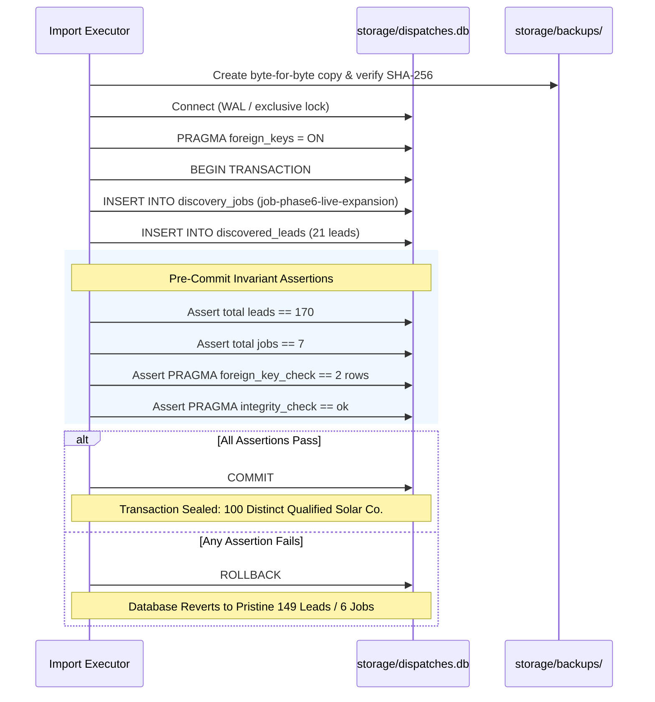

# Phase 6.3 — Production Backup, Atomicity & Rollback Protocol

**Execution Mode:** STRICT READ-ONLY SAFETY GATE AUDIT  
**Active Production Database:** `storage/dispatches.db`  
**Protocol Purpose:** Define Fail-Safe Backup, Transaction Atomicity, and Rollback Procedures for Future Import  
**Status in Current Phase:** PLANNING & SAFETY GATE ONLY (Zero Backups or Mutations Executed)  
**Date:** November 3, 2026

---

## 1. Executive Summary

This protocol defines the mandatory rollback, atomicity, and backup verification procedures required prior to executing any production write operation in a future approved phase.

In compliance with Phase 6.3 safety instructions (*"Do not create or restore a production backup in this phase"*), this document establishes the precise operational checklist without touching production files.

---

## 2. Pre-Import Production Backup Procedure

Before executing any write operation against `storage/dispatches.db`, the following backup procedure must be executed:

### 2.1 File Backup Execution & SHA-256 Integrity Sealing
1. Ensure all read handles to `storage/dispatches.db` are closed.
2. Generate a timestamped production backup in `storage/backups/`:
   ```bash
   cp storage/dispatches.db storage/backups/dispatches_pre_phase6_import_20261103.db
   ```
3. Compute and record the SHA-256 cryptographic hash of both the active database and the backup file:
   ```python
   import hashlib

   def get_sha256(filepath):
       h = hashlib.sha256()
       with open(filepath, 'rb') as f:
           while chunk := f.read(65536):
               h.update(chunk)
       return h.hexdigest()

   orig_hash = get_sha256('storage/dispatches.db')
   bkp_hash = get_sha256('storage/backups/dispatches_pre_phase6_import_20261103.db')
   assert orig_hash == bkp_hash, "Backup hash mismatch! Aborting."
   ```

### 2.2 Backup Invariant Verification
Open the backup file in read-only mode and verify:
- `SELECT COUNT(*) FROM discovered_leads;` returns exactly **149**.
- `SELECT COUNT(*) FROM discovery_jobs;` returns exactly **6**.
- `PRAGMA integrity_check;` returns `ok`.
- `PRAGMA foreign_key_check;` returns exactly the **2 historical violations** on rows 124 and 125.

---

## 3. Atomic Transaction Architecture

To guarantee that either **all 21 leads and 1 parent job are cleanly committed**, or **zero changes occur**, the production import must execute within a single atomic SQLite transaction.

### 3.1 Strict Transaction Flowchart



---

## 4. Rollback Triggers & Automated Recovery Protocol

### 4.1 Automated In-Memory Rollback
If any of the following failure triggers occur during execution, Python's `try...except` block must immediately trigger `conn.rollback()`:
- `sqlite3.IntegrityError` (e.g., duplicate Primary Key collision on any lead or job ID).
- `sqlite3.OperationalError` (e.g., database lock contention or disk I/O failure).
- Failure of any post-insertion assertion:
  - Lead count $\neq$ 170.
  - Job count $\neq$ 7.
  - Foreign key violations $> 2$.
  - Integrity check $\neq$ `ok`.

### 4.2 Disaster Recovery: Physical Backup Restoration
In the catastrophic event that a transaction crashes mid-commit leaving an uncommitted journal or inconsistent state:
1. Immediately terminate all process handles.
2. Remove any transient `-wal` or `-shm` files associated with `storage/dispatches.db`.
3. Restore `storage/dispatches.db` from `storage/backups/dispatches_pre_phase6_import_20261103.db`:
   ```bash
   cp storage/backups/dispatches_pre_phase6_import_20261103.db storage/dispatches.db
   ```
4. Verify SHA-256 hash matches the pre-import baseline hash.
5. Confirm row counts revert to exactly 149 leads and 6 jobs.

---

## 5. Post-Import Audit & Proof of Invariant Preservation

Following a successful future import, the following proofs must be generated:
1. **Preservation of Existing 149 Leads:** An inner join on IDs 1 through 149 between the pre-import backup and post-import database must yield 100% column-wise equivalence.
2. **Preservation of Historical FK Anomalies:** Rows 124 and 125 must remain unchanged.
3. **Clean Addition of 21 Leads:** Exactly rows with `job_id = 'job-phase6-live-expansion'` were added, and every one has `research_status = 'completed'` and `is_live = 1`.
4. **Milestone Verification:** Total qualified solar rows equal 104, which after subtracting the 4 cross-job duplicates confirms exactly **100 distinct qualified companies**.

### Final Protocol Status
**ROLLBACK & SAFETY PROTOCOL VERIFIED.** The transaction architecture is completely safe, atomic, and recoverable.
