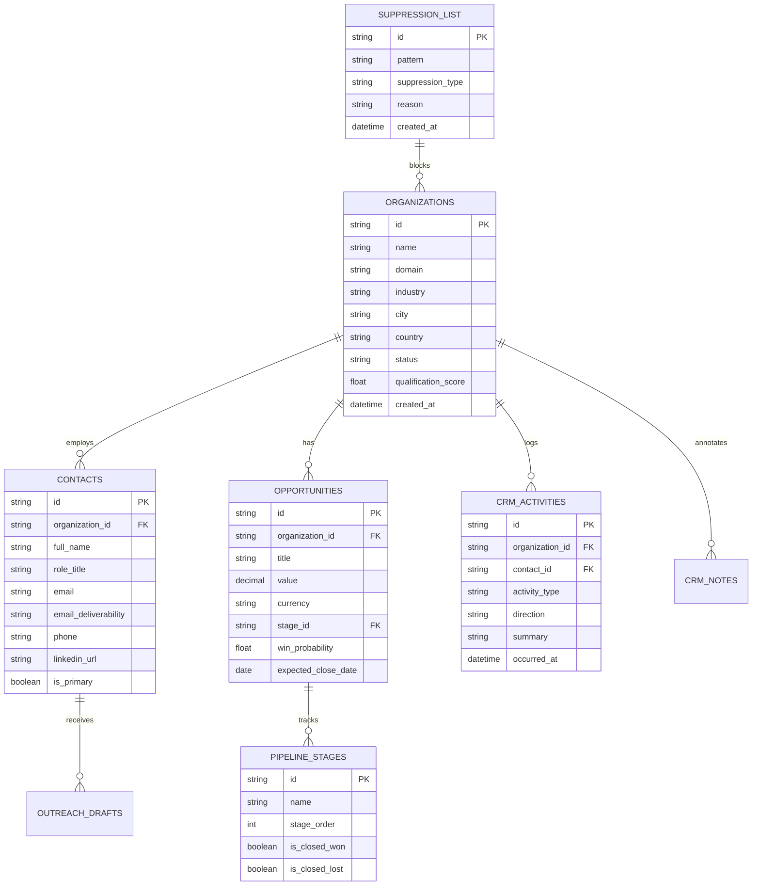

# AgentDesk — Phase A.1: CRM & Sales Workflow Audit

**Audit Date:** November 5, 2026  
**Auditor:** Antigravity AI Systems Architecture Team  
**Evaluation Target:** Current sales pipeline capabilities in `storage/dispatches.db`, `backend/dispatch_tracker.py`, `src/components/OutreachConsole.tsx`, and `src/components/OutreachHistory.tsx`.

---

## 1. CRM & Sales Workflow Capability Matrix

| Sales Workflow Capability | Current State in Codebase | Technical Implementation | Gaps & Limitations |
| :--- | :---: | :--- | :--- |
| **Lead Status Lifecycle** | Partial | `discovered_leads.research_status` (`completed`, `skipped`, `failed`); `outreach_drafts.status` (`drafted`, `approved`, `rejected`, `sent`). | No CRM deal/pipeline lifecycle (e.g., `lead`, `contacted`, `replied`, `meeting_scheduled`, `proposal_sent`, `closed_won`, `closed_lost`). |
| **Operator Notes** | Minimal | `outreach_drafts.grounding_notes` records automated LLM fact provenance. | Zero manual operator note-taking capability. No timestamped internal notes table for sales reps. |
| **Interaction History** | Single-Event Log | `outreach_history` logs initial email draft and dispatch events (`sent`, `simulated`, `failed`). | Does not track customer replies, inbound inquiries, phone call summaries, or demo meetings. |
| **Contact Records (People vs. Accounts)** | Flat / Denormalized | Contact info (`recipient_name`, `recipient_role`, `recipient_email`, `phone`) is embedded directly in the `discovered_leads` or `outreach_drafts` record. | No separate `contacts` table. Cannot link multiple stakeholders (e.g. CEO, CTO, Procurement Manager) to the same company account. |
| **Opportunity / Deal Tracking** | **None (0%)** | Zero opportunity models or tables. | Cannot track deal value ($), currency, expected close date, service package, or probability weighting. |
| **Pipeline Stages & Kanban** | **None (0%)** | UI only displays flat tables for discovery and drafts. | No visual Kanban board; no stage progression drag-and-drop; no velocity metrics. |
| **Follow-Up Scheduling** | **None (0%)** | Zero task or reminder logic. | No snooze feature, no scheduled follow-up dates, no automated reminder notifications for sales reps. |
| **Suppression Lists & Opt-Outs** | Partial (Hash only) | Prevents duplicate dispatches using `dispatched_records` (SHA-256 content hash and draft ID). | No domain-level or email-level exclusion list. Does not store unsubscribe requests, competitor domain blocks, or customer exclusions. |
| **Human-in-the-Loop Approval** | **Complete (10/10)** | Enforced in `main.py` (`send_outreach` requires `approved: true`). UI provides edit modal and approve/discard buttons. | Robust and working cleanly. |
| **Audit Logs** | High (8/10) | `outreach_history` records timestamps, provider modes, error messages, and recipient metadata. | Lacks an application-wide audit log for user actions (e.g. who edited a contact, who changed a stage). |

---

## 2. Identified Schema & Workflow Deficiencies

The current architecture is optimized for **unidirectional outreach generation**, rather than a **bidirectional CRM operating system**. 

### Key Deficiencies:
1. **Denormalized Organization Data:** If a company is discovered in Job 1 and re-discovered in Job 2, two separate `discovered_leads` records are created with identical company metadata, leading to fragmented history.
2. **Missing Contact Entity:** Enterprise sales requires reaching multiple stakeholders. In the current database, an organization can only have one recipient email and one recipient name attached to a draft.
3. **Missing Inbound Communication Loop:** The system can record that an email was sent, but cannot ingest a reply, mark a lead as "Replied", or update conversation status.
4. **Lack of Sales Cadences / Sequences:** Outreach is strictly one-shot. There is no automated follow-up sequence (e.g. Step 1: Cold Email -> Wait 3 days -> Step 2: Follow-up Email if no reply).

---

## 3. Required Database Changes for Phase A CRM Architecture

To transition AgentDesk into a complete Agency + SaaS CRM, the following relational schema design is proposed.

> [!IMPORTANT]
> **Safety Protocol Compliance:** In accordance with Phase A.1 safety directives, **no migrations are executed during this audit**. The schemas below are specification designs for Phase A implementation tickets.

### Proposed Table Definitions (Draft Specifications)

#### 1. `organizations` (Replaces fragmented discovered lead company records)
- `id TEXT PRIMARY KEY`
- `domain TEXT UNIQUE NOT NULL` (Canonical domain, e.g. `reonenergy.com`)
- `company_name TEXT NOT NULL`
- `industry TEXT`
- `city TEXT`
- `country TEXT`
- `website TEXT NOT NULL`
- `services_description TEXT`
- `qualification_score REAL DEFAULT 0.0` (0–100 score)
- `qualification_tier TEXT DEFAULT 'Tier 3'` ('Tier 1', 'Tier 2', 'Tier 3')
- `lifecycle_status TEXT DEFAULT 'lead'` ('lead', 'prospect', 'opportunity', 'client', 'churned', 'archived')
- `created_at TEXT NOT NULL`
- `updated_at TEXT`

#### 2. `contacts` (Enables multiple decision-makers per account)
- `id TEXT PRIMARY KEY`
- `organization_id TEXT NOT NULL REFERENCES organizations(id) ON DELETE CASCADE`
- `full_name TEXT NOT NULL`
- `role_title TEXT`
- `email TEXT`
- `email_verification_status TEXT NOT NULL DEFAULT 'unverified'`
- `phone TEXT`
- `phone_verification_status TEXT NOT NULL DEFAULT 'unverified'`
- `linkedin_url TEXT`
- `is_primary_contact INTEGER NOT NULL DEFAULT 0`
- `created_at TEXT NOT NULL`

#### 3. `opportunities` (Tracks sales pipeline deals)
- `id TEXT PRIMARY KEY`
- `organization_id TEXT NOT NULL REFERENCES organizations(id) ON DELETE CASCADE`
- `primary_contact_id TEXT REFERENCES contacts(id)`
- `deal_name TEXT NOT NULL` (e.g. "Reon Energy — Solar Net-Metering Portal")
- `deal_value REAL NOT NULL DEFAULT 0.0`
- `currency TEXT NOT NULL DEFAULT 'USD'`
- `pipeline_stage TEXT NOT NULL DEFAULT 'discovery'` ('discovery', 'demo_scheduled', 'proposal_sent', 'negotiation', 'won', 'lost')
- `win_probability REAL NOT NULL DEFAULT 0.20`
- `expected_close_date TEXT`
- `loss_reason TEXT`
- `created_at TEXT NOT NULL`
- `updated_at TEXT`

#### 4. `suppression_list` (Enforces global do-not-contact rules)
- `id TEXT PRIMARY KEY`
- `entry_value TEXT NOT NULL UNIQUE` (Email address or domain, e.g. `competitor.com`, `user@domain.com`)
- `entry_type TEXT NOT NULL` ('email', 'domain', 'phone')
- `reason TEXT NOT NULL` ('unsubscribed', 'competitor', 'bounced', 'manual_exclusion')
- `created_at TEXT NOT NULL`

#### 5. `crm_notes` & `crm_tasks` (Follow-up scheduling and operator collaboration)
- `crm_notes`: `id`, `organization_id`, `author_name`, `content`, `created_at`
- `crm_tasks`: `id`, `organization_id`, `assigned_to`, `task_type` ('follow_up_email', 'phone_call', 'send_proposal'), `due_date`, `is_completed`, `created_at`

